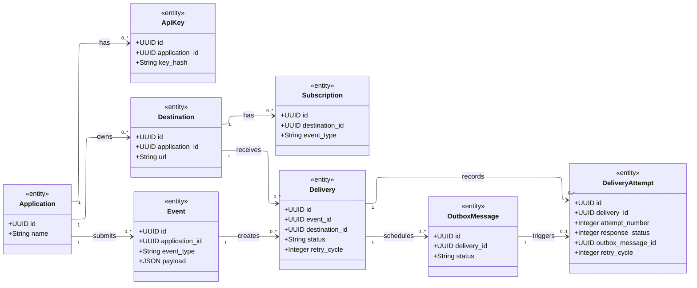

# Database Relationships

Status: Initial design proposal

## Purpose

This document describes the planned database entities, their relationships,
and the rules that the database must enforce.

The diagram represents the proposed database structure.
It does not represent implemented database tables yet.

## Entity Relationship Diagram

The diagram uses UML class notation.

Each class represents a planned database table.
Each relationship shows how records in those tables are connected.

## Relationship Rules

### Application — ApiKey

**Relationship:**

- One Application can own zero or many API keys.
- Each API key belongs to exactly one Application.

**Database requirements:**

- Every API key must reference an existing Application.
- `application_id` cannot be empty.
- `key_hash` cannot be empty.
- `key_hash` must be unique.
- The database stores the API key hash, not its original secret.

### Application — Destination

**Relationship:**

- One Application can own zero or many Destinations.
- Each Destination belongs to exactly one Application.

**Database requirements:**

- Every Destination must reference an existing Application.
- `application_id` cannot be empty.
- `url` cannot be empty.
- The application must validate that `url` contains a valid HTTP or HTTPS address.

### Application — Event

**Relationship:**

- One Application can submit zero or many Events.
- Each Event belongs to exactly one Application.

**Database requirements:**

- Every Event must reference an existing Application.
- `application_id` cannot be empty.
- `event_type` cannot be empty.
- `payload` must contain valid JSON data.

### Destination — Subscription

**Relationship:**

- One Destination can have zero or many Subscriptions.
- Each Subscription belongs to exactly one Destination.

**Database requirements:**

- Every Subscription must reference an existing Destination.
- `destination_id` cannot be empty.
- `event_type` cannot be empty.
- A Destination cannot have duplicate Subscriptions for the same `event_type`.

The last requirement needs a composite unique constraint.

A composite unique constraint means that the database checks multiple columns together.

Here, the combination of `destination_id` and `event_type` must be unique.

### Event — Delivery

**Relationship:**

- One Event can create zero or many Deliveries.
- Each Delivery belongs to exactly one Event.

**Database requirements:**

- Every Delivery must reference an existing Event.
- `event_id` cannot be empty.
- An Event can produce zero Deliveries when no subscriptions match its event type.
- The same Event cannot produce multiple Deliveries for the same Destination.

The final requirement needs a composite unique constraint.

The combination of `event_id` and `destination_id` must be unique.

### Destination — Delivery

**Relationship:**

- One Destination can receive zero or many Deliveries.
- Each Delivery targets exactly one Destination.

**Database requirements:**

- Every Delivery must reference an existing Destination.
- `destination_id` cannot be empty.
- An Event and its Destination must belong to the same Application.

The last requirement prevents one Application's Event from being delivered to another Application's Destination.

### Delivery — DeliveryAttempt

**Relationship:**

- One Delivery can have zero or many DeliveryAttempts.
- Each DeliveryAttempt belongs to exactly one Delivery.

**Database requirements:**

- Every DeliveryAttempt must reference an existing Delivery.
- `delivery_id` cannot be empty.
- `attempt_number` must be greater than zero.
- Attempt numbers must be unique within each Delivery.
- `response_status` may be empty when no HTTP response was received.

Attempt numbers identify the order in which delivery attempts occurred.

For example, one Delivery could have attempts numbered 1, 2, and 3.

### Delivery — OutboxMessage

**Relationship:**

- Every Delivery has exactly one OutboxMessage.
- Every OutboxMessage belongs to exactly one Delivery.

**Database requirements:**

- Every OutboxMessage must reference an existing Delivery.
- `delivery_id` cannot be empty.
- `delivery_id` must be unique.
- The Delivery and its OutboxMessage must be created within the same database transaction.

The transactional requirement is important.

It ensures that a Delivery cannot be saved without its corresponding OutboxMessage.

An OutboxMessage records that a Delivery needs background processing.

## General Database Requirements

- Every entity must have a primary key.
- Every foreign key must reference an existing record.
- Foreign keys must not be empty where the relationship requires a record.
- Composite unique constraints must prevent duplicate records where specified.

## Decisions Deferred Until Implementation

The following details are not finalised yet:

- Exact status values for Deliveries and OutboxMessages.
- What happens to related records when an Application is deleted.
- How API keys are revoked and expired.
- How long Events and DeliveryAttempts are retained.
- Which timestamps each table needs.
- How duplicate incoming Events are detected.
- How delivery retries and retry delays work.

These decisions will be addressed when we implement the relevant functionality.
